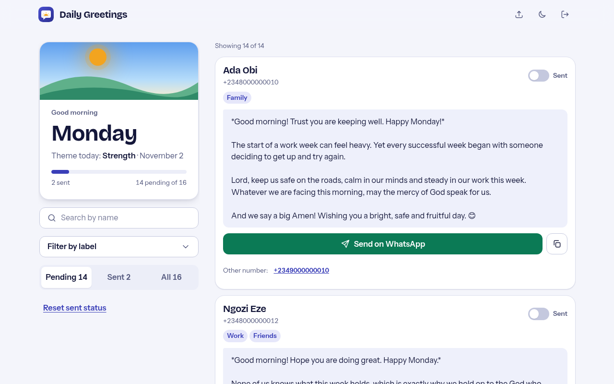
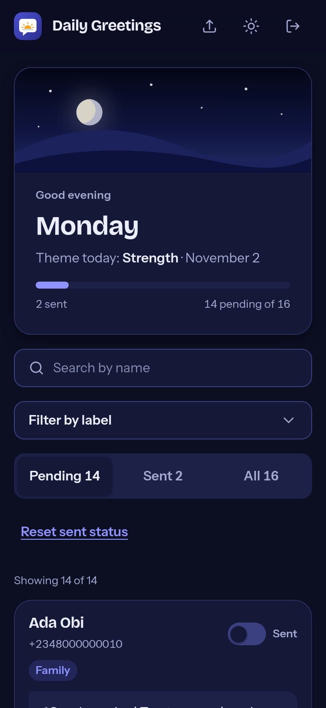

# Daily Greetings

A private WhatsApp greeting assistant. Each day it writes warm, prayerful messages that fit the day of the week and the time of day. You review a message, tap one button, and WhatsApp opens ready to send. It keeps track of who you have already greeted.

**Live site:** https://babatundeawo.github.io/wa-greetings/ (sign-in required)

*Screenshots use made-up names and numbers.*

## What it does

- Writes a different message for every contact and every day, in plain Nigerian-friendly English, with a theme for each weekday and for the first of the month.
- Matches the wording to the time of day. The sky above today's date does too: its colours and the sun or moon follow the real hour.
- Sends through WhatsApp click-to-chat. You can edit any message first, or copy it.
- Tracks who has been greeted, with Pending, Sent and All views, label filters, search, and one-tap reset.
- Imports a Google Contacts CSV and shows what will change before saving.
- Works as an installable app on Android, desktop and iPhone, with a calm update prompt.
- Light and dark themes, keyboard friendly (press `/` to search), accessible, and fast on a phone.

## Privacy

- Your contacts live only in your private Firebase database. They are **never** in this repository.
- Only the owner's account can read or write them. The database rules check your user ID.
- Contacts are not stored on the device. Signing out or closing the app clears everything.
- The site asks search engines not to list it, and loads no third-party scripts or fonts except Firebase's own services (and Google reCAPTCHA if you switch on App Check).

## How it is built

Plain HTML, CSS and JavaScript, bundled by [esbuild](https://esbuild.github.io/) inside GitHub Actions. Hosted free on GitHub Pages. Sign-in and data use Firebase Authentication and Cloud Firestore on the free Spark plan. There is no server of your own to run.

| Folder or file | Purpose |
| --- | --- |
| `src/` | The app: page templates, `main.js`, the message writer (`messages.js`), the importer, the service worker |
| `src/styles/` | Design tokens and styles |
| `public/` | Files copied as they are: icons, manifest, screenshots, font licences |
| `scripts/` | `build.mjs` builds the site; `verify.mjs` checks the result |
| `firestore.rules` | The database rules you paste into Firebase |
| `docs/` | Step-by-step guides |
| `.github/workflows/` | Build, checks and publishing |

## Guides

- [First-time setup and moving to this version](docs/DEPLOYMENT.md)
- [Firebase setup, rules, secrets and App Check](docs/FIREBASE_SETUP.md)
- [Changing messages, colours and wording](docs/CUSTOMIZING.md)

## Credits

Fonts: [Bricolage Grotesque](https://github.com/ateliertriay/bricolage) and [Instrument Sans](https://github.com/Instrument/instrument-sans), both under the SIL Open Font License (see `public/licenses/`). No licence has been chosen for the code; all rights reserved by the owner.
